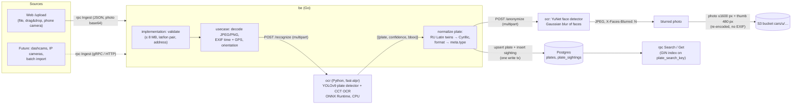

# OCR pipeline: photo → plate → sighting

How sightings get into car-search: a photo comes in, a plate recognizer reads the plate,
the backend normalizes it, stores the photo in S3 and the plate and sighting in Postgres,
and the sighting becomes searchable right away.

## Flow

Steps of `rpc Ingest` (`be/internal/usecase/ingest.go`):

0. **Sign-in and quota**: uploads require a user token (cookie `cs_token` or `Authorization: Bearer`);
   anonymous requests get `UNAUTHENTICATED` (“sign in to upload photos”) — the quota is per user, and
   anonymous uploads would be an easy abuse vector. Free plan: at most 5 uploads in a rolling 24 h
   window, counted by `plate_sightings.uploaded_by` / `uploaded_at` (not `created_at`, which is the
   shot time from EXIF); over the limit → `RESOURCE_EXHAUSTED`. Pro: unlimited. The check runs before
   OCR (to not waste recognition) and again inside the write transaction with the user row locked
   (`SELECT … FOR UPDATE`), so parallel uploads cannot exceed the limit. Remaining uploads are returned
   in `IngestResponse.uploads_left` and `MeResponse.uploads_left` and shown on `/upload`.
1. **Validate** (`implementation/ingest.go`): photo present and ≤ 8 MB, `lat`/`lon` only as a pair
   and in range, address ≤ 300 chars. Over HTTP (clay) the request is JSON, so `bytes photo`
   is a base64 string; gRPC accepts up to 9 MB messages.
2. **Decode** the image (JPEG/PNG; anything else → `INVALID_ARGUMENT`), read EXIF:
   `DateTimeOriginal` → sighting time, GPS → coordinates, `Orientation` → rotation.
   Values from the request win over EXIF; time defaults to *now*, a time in the future is clamped to now.
3. **Recognize**: `POST http://ocr:8000/recognize` with a 15 s timeout. Network errors, timeouts
   and 5xx → `UNAVAILABLE` (“recognition service unavailable”).
4. **Normalize** every candidate (`usecase/plate_format.go`):
   - RU first: Latin look-alikes → Cyrillic (`P466YK79` → `Р466УК 79`), `0` ↔ `О` by position,
     region of 2–3 digits (the model sometimes drops it — then the series alone is stored);
   - otherwise heuristic formats: US (California `7ABC123`), EU (FR/IT `AB 123 CD`,
     ES `1234 ABC` → region `E`, DE `MKD4419` → region `D`); anything else — type unknown.
5. **Pick** the candidate with the highest confidence. Below `MinPlateConfidence` (0.5) or none →
   `INVALID_ARGUMENT` “plate not recognized”.
6. **Anonymize**: `POST http://ocr:8000/anonymize` (same client, same 15 s timeout) with the original
   photo; the service returns a JPEG with blurred faces (header `X-Faces-Blurred: N`). This runs
   *after* recognition (the plate is read from the original) and *before* anything is stored. Any
   failure (network, timeout, non-200, not an image) → `UNAVAILABLE`: an unblurred photo is never saved.
   The blurred JPEG replaces the original for everything below, including the thumbnail
   (EXIF time/GPS still come from the original).
7. **Store photos** in S3 under `u/<uuid>.jpg` (≤ 1600 px wide) and `u/<uuid>_thumb.jpg` (480 px),
   re-encoded as JPEG (EXIF, including GPS, is not kept in the stored files).
8. **Write** in one transaction: find-or-create the plate (`plates.meta = {type, region}`),
   insert the sighting (`is_test_data = false`, `address_locale` detected from the address script:
   Cyrillic → `ru`/`uk`, Han → `zh`, Latin with umlauts → `de`, Latin → `en`, empty → `ru`).
9. **Respond** with the created sighting and all candidates with confidence and bbox.

The sighting is immediately visible to `rpc Search`: the plate goes through the same
`plate_search_key()` as every other plate, so `р466ук`, `P466YK`, `0515` etc. match.

## Models

The `ocr/` service wraps [fast-alpr](https://github.com/ankandrew/fast-alpr) (MIT):

| Stage | Default model | Size | Source |
|---|---|---|---|
| Plate detection | `yolo-v9-t-384-license-plate-end2end` ([open-image-models](https://github.com/ankandrew/open-image-models)) | 7.4 MB ONNX | GitHub releases |
| Plate OCR | `cct-xs-v2-global-model` ([fast-plate-ocr](https://github.com/ankandrew/fast-plate-ocr)) | ~3 MB ONNX | GitHub releases |

| Face detection | YuNet `face_detection_yunet_2023mar` ([opencv_zoo](https://github.com/opencv/opencv_zoo), Apache-2.0), via `cv2.FaceDetectorYN` | 0.23 MB ONNX | GitHub (SHA-256 checked in the Dockerfile) |

Weights are public, no API keys. They are downloaded during `docker build` and baked into the image
(image ≈ 600 MB, face model adds ~0.2 MB: python slim + onnxruntime + OpenCV headless).

**Speed (CPU, Apple Silicon via Colima, 1600×1067 photo):** ~60–170 ms per photo end-to-end
in the OCR service (detector + OCR), first request after start slightly slower.

**Accuracy (small sample, CC0 photos from `be/internal/test_utils/s3/cars/CREDITS.md`, originals):**

| Photo | Truth | `cct-xs-v2` (default) | `cct-s-v1` | `cct-s-v2` |
|---|---|---|---|---|
| car-1 | Р466УК 799 | `P466YK79` (0.94) — last region digit lost | `P466Y799` | `4666K799` |
| car-2 | Н311УО 797 | `H311YO797` (0.98) — exact | `311Y0797` | `7111777` |
| car-3/7/9 | plate blurred by author | nothing above threshold | — | — |

The global models are trained on many countries but Russian plates are not their strong side:
the small two-row-ish region box is the usual failure point. Expect series to be right much more
often than the region. A Russia-specific OCR model would be the first improvement (see below).

## Replacing the model

- **Another fast-alpr model** — no code changes: set `OCR_DETECTOR_MODEL` / `OCR_MODEL` env vars
  for the `ocr` service (build-time download happens in `server.load()`, so also rebuild the
  image to bake the new weights). Available OCR models: `cct-{xs,s}-v{1,2}-global-model`,
  `global-plates-mobile-vit-v2-model`, `european-plates-mobile-vit-v2-model`, … — see
  `fast_plate_ocr.inference.hub.OcrModel`.
- **Custom / fine-tuned ONNX** (e.g. fast-plate-ocr trained on RU plates): fast-alpr accepts
  custom model and config paths; copy them into the image and pass them in `server.load()`.
- **A completely different engine** (PaddleOCR, EasyOCR, a cloud API): keep the HTTP contract —
  `POST /recognize`, multipart field `image`, response `[{"plate", "confidence", "bbox"}]`,
  plate as Latin letters + digits without separators. The backend only depends on this contract
  (`be/internal/ocr`, interface `recognizer` in `usecase/contracts.go`).
- Tune the acceptance threshold in `usecase.MinPlateConfidence`.

## Future sources

All sources should go through `rpc Ingest` (gRPC on :8082 or HTTP JSON), so normalization,
storage and dedup logic stay in one place:

- **Dashcams / phones in the car**: an uploader app that sends frames with GPS and timestamp
  (`taken_at`, `lat`, `lon`) — EXIF is not needed then.
- **IP cameras**: a small sidecar that pulls RTSP, runs motion/plate detection locally (the same
  detector model) and sends only frames with a plate, rate-limited per plate.
- **Batch import** (folders of photos): a CLI that walks a directory and calls `Ingest` per file
  with bounded concurrency; EXIF supplies time and place.
- Planned additions for non-interactive sources: an API key per source, a `source` field on the
  sighting, idempotency key (hash of the photo) to avoid duplicates, and an async queue if OCR
  becomes the bottleneck.

## Privacy

A licence plate together with time and place is **personal data** (it can identify a person's
movements). Current state and TODO:

- Stored: the re-encoded photo and thumbnail (no EXIF), plate, time, optional address and coordinates.
  Original uploads are not kept.
- Users can report a photo (“Report” → `COMPLAINT_REASON_PERSONAL_DATA`), moderators handle it
  in `/admin`.
- **Faces are blurred before storing** (step 6). `ocr/server.py` `/anonymize`: YuNet detector
  (score ≥ 0.5, NMS 0.3), the image is downscaled to ≤ 1920 px on the long side for detection, each
  box is expanded by 20 % per side and blurred with a strong Gaussian (kernel ≈ ⅓ of the box, so even a
  large face becomes a smudge), then re-encoded as JPEG (q92). Plates are deliberately **not** blurred
  (they are what the service records). CPU cost ≈ tens of ms per photo.
  - *Accuracy* (spot check on CC0 Wikimedia street photos, 1920 px): all faces turned towards the
    camera (7/7, 12/12 and 8/8 detections in three street scenes, including a face behind a van window)
    were blurred. Misses to expect: heads seen from behind or in strong profile, very small/distant
    people (< ~20 px faces), heavy occlusion, masks/sunglasses at an angle. The threshold is tuned for
    recall, so false positives happen (a car wheel got blurred in one test). This is a best-effort
    measure, not a guarantee — keep the report button and moderation.
  - Not covered: other plates in the frame (not blurred), people recognizable by body/clothes,
    text on signs; the OCR service sees the original photo in memory only (nothing is persisted there).
  - Tunables (env of `ocr`): `FACE_SCORE` (detector threshold), `FACE_MODEL` (path to another YuNet/ONNX).
- **TODO:** retention policy (delete photos after N days, keep only plate + time + coarse place),
  authentication/rate limiting for `Ingest`, cleanup of orphaned S3 objects when the DB write fails.
- The OCR service has no published port and is reachable only inside the compose network.
